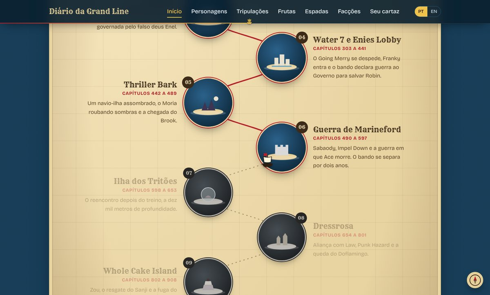
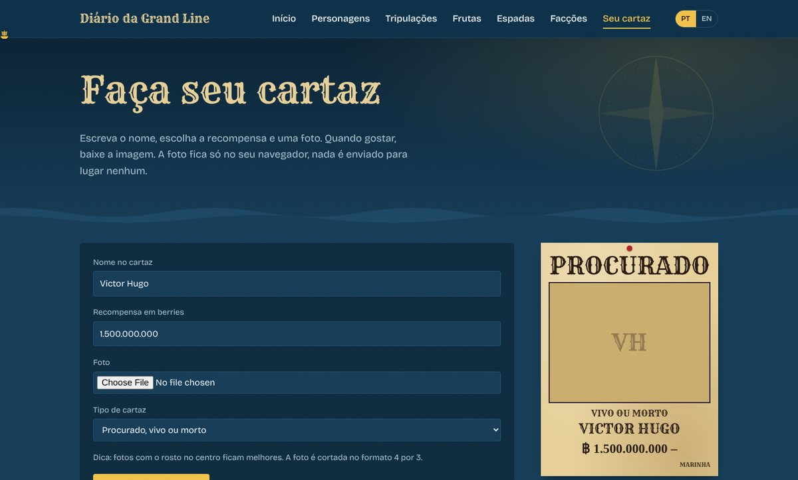
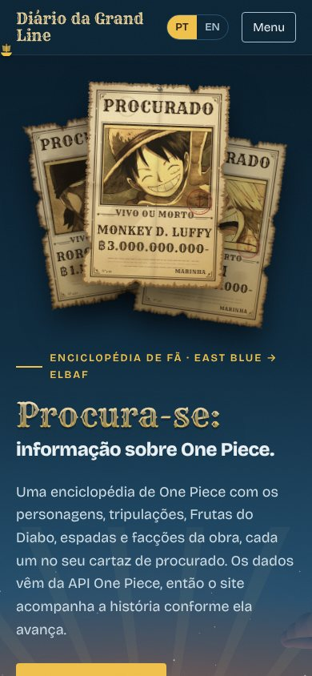

# Diário da Grand Line

Uma enciclopédia de One Piece feita por fã: personagens, tripulações, Frutas do Diabo, espadas e as facções que mandam no mundo. Os dados vêm da [API One Piece](https://api-onepiece.com/), então as listas crescem sozinhas quando ela é atualizada.

**[Abrir o site](https://viktorhso.github.io/site-onepiece/)**


## O que tem no site

- **Personagens:** os 786 personagens da API em cartazes de procurado, com busca, filtro por tripulação e situação e ordenação por recompensa. Cada cartaz abre uma ficha com idade, altura, fruta e recompensa.
- **Quem vale mais:** as dez maiores recompensas, com barras para comparar.
- **Abertura em camadas:** um pôr do sol desenhado em SVG (céu, Red Line, ilhas, navio e três faixas de mar) com parallax no scroll e no mouse.
- **Jornal Econômico Mundial:** manchetes passando logo abaixo da abertura, e os números da API contando ao aparecer.
- **A rota do bando:** uma carta náutica com as sagas na ordem, de East Blue até Elbaf. O caminho é desenhado e um navio segue a rota conforme a página rola.
- **Tripulações:** tabela com capitão, número de membros, recompensa somada e a lista de quem faz parte.
- **Frutas do Diabo:** as 213 frutas por tipo, com descrição em português e quem comeu cada uma.
- **Espadas:** as espadas famosas separadas por grau (Saijo O Wazamono, O Wazamono, Ryo Wazamono).
- **Facções:** Imperadores, Pior Geração, Marinha, Exército Revolucionário e Governo Mundial, com os principais nomes de cada grupo.
- **Seu cartaz:** você escreve seu nome, escolhe a recompensa e uma foto, arrasta e dá zoom na foto direto no cartaz e baixa um PNG de 1200×1700. O cartaz é desenhado num canvas com papel envelhecido (fibras, manchas, dobras, borda rasgada e queimada), tinta com falhas de impressão, carimbo e prego. Dá para escolher entre cinco fontes antigas, três níveis de desgaste, foto em sépia, preto e branco ou colorida, e três tipos de cartaz. No iPhone o download abre o menu de compartilhar. A foto não sai do navegador.
- **Português e inglês:** o botão PT | EN no topo troca o site inteiro.

| | |
|---|---|
|  |  |

<p align="center"></p>

## Como rodar

É HTML, CSS e JavaScript puro, sem nenhuma instalação. Dá para abrir o `index.html` direto no navegador, mas o jeito mais confiável é usar a extensão **Live Server** do VS Code (botão *Go Live*). O site precisa de internet para buscar os dados na API.

## Como o código está organizado

```
index.html                     página inicial
pages/                         personagens, tripulações, frutas, espadas, facções e seu cartaz
assets/css/style.css           todo o visual
assets/js/api.js               busca os dados na API e deixa tudo num formato simples
assets/js/ui.js                peças usadas em todas as páginas: menu, cartaz, janela de detalhes
assets/js/cartaz-arte.js       desenho dos cartazes no canvas (oficina)
assets/img/cartaz/             papéis envelhecidos prontos, usados por todos os cartazes do site
assets/js/efeitos.js           movimento: parallax, barra de progresso, revelar ao rolar, carta náutica, voltar ao topo
assets/js/idioma.js            troca de idioma e todas as frases do site
assets/js/descricoes-pt.js     descrições das frutas e espadas em português
assets/js/fotos.js             personagens com foto na pasta assets/img/personagens
assets/js/fotos-anilist.js     fotos dos personagens vindas da AniList
assets/js/pages/*.js           o código de cada página
assets/img/personagens/        fotos do bando do Chapéu de Palha
docs/                          imagens deste README
```

Todo o JavaScript fica dentro de um único objeto, `OP`, para uma página não sobrescrever as funções da outra.

### Cartazes

Todos os cartazes do site usam o mesmo papel envelhecido da oficina. Para aparecerem na hora, o papel é uma imagem pronta (`assets/img/cartaz/`), gerada com o `cartaz-arte.js` no modo `soPapel`, sem textos. O nome, a foto e a recompensa vão por cima em HTML, com o tamanho de cada texto calculado pela largura das letras da fonte Rye para caber numa linha.

### Rosto no centro do cartaz

As fotos da AniList têm enquadramentos bem diferentes (rosto no topo, corpo inteiro, close). Em `assets/js/fotos-anilist.js`, o `OP.ROSTO_ANILIST` guarda onde fica o rosto em cada foto, conferido à mão. Com isso o `OP.enquadrar` calcula o zoom e a posição que deixam o rosto no centro do quadro do cartaz. Quem não tem foto aparece com uma silhueta e uma interrogação.

### Cache do navegador

Os arquivos de CSS e JS são carregados com `?v=9` no fim do endereço. Quando mudar algum deles, aumente esse número em todos os HTML: assim o navegador baixa a versão nova em vez de misturar o HTML novo com o CSS antigo guardado.

### Movimento e acessibilidade

Todo o movimento fica em `assets/js/efeitos.js` e roda num único `requestAnimationFrame` por quadro. Quem liga "reduzir movimento" no sistema vê o site parado, com todo o conteúdo já visível. Os desenhos são SVG feitos para o site, sem imagens externas, então a política de segurança (CSP) continua a mesma.

### Fotos de personagens

A API One Piece não tem fotos de personagens (só tem imagem de 23 frutas). As fotos vêm da [AniList](https://anilist.co/anime/21/ONE-PIECE/characters): `assets/js/fotos-anilist.js` liga o id de cada personagem da API à imagem dele, e hoje cobre 355 personagens, incluindo quase todos os principais. O nome que aparece no site é sempre o da API One Piece.

Para trocar ou acrescentar uma foto, salve a imagem como `assets/img/personagens/<id>.webp` e coloque o id na lista de `assets/js/fotos.js`. Fotos locais têm prioridade sobre as da AniList. Quem não tem foto aparece com as iniciais.

### Idiomas

Os textos fixos do HTML têm o atributo `data-i18n="chave"`, e a versão em inglês fica em `assets/js/idioma.js`. Os textos montados pelo JavaScript usam `OP.t('chave')`. A API só tem inglês e francês, então as descrições em português das frutas e espadas foram traduzidas para o site e ficam em `assets/js/descricoes-pt.js`.

## Créditos

- Dados: [API One Piece](https://api-onepiece.com/)
- Fotos dos personagens: [AniList](https://anilist.co)
- Fontes do Google Fonts: [Rye](https://fonts.google.com/specimen/Rye), [Bricolage Grotesque](https://fonts.google.com/specimen/Bricolage+Grotesque), [Pirata One](https://fonts.google.com/specimen/Pirata+One), [IM Fell English SC](https://fonts.google.com/specimen/IM+Fell+English+SC), [IM Fell DW Pica](https://fonts.google.com/specimen/IM+Fell+DW+Pica), [Uncial Antiqua](https://fonts.google.com/specimen/Uncial+Antiqua) e [Grenze Gotisch](https://fonts.google.com/specimen/Grenze+Gotisch)

One Piece pertence a Eiichiro Oda, Shueisha e Toei Animation. Este é um projeto de fã, sem fins lucrativos.

## Autor

Feito por Victor Hugo Sousa Oliveira.
